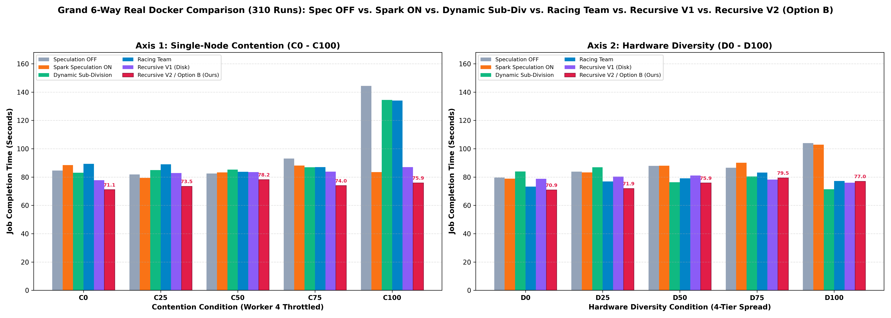

# Straggler Detection and Mitigation in Heterogeneous Big-Data Clusters

**An Empirical Evaluation of Speculative Execution, Capacity-Aware Task Sub-Division, Racing Team Speculation, and Hierarchical Recursive Work-Stealing under Controlled CPU Contention and Hardware Diversity**

[](https://www.python.org/downloads/)
[](https://spark.apache.org/)
[](https://www.docker.com/)

---

## 👥 Authors & Academic Affiliation
- **Student Researchers:** Pakalapati Gokul Chinna, Padarthy Sailesh Sai, Mothukuri Sai Teja
- **Faculty Mentor:** Dr. Lachure Jaykumar Suraj
- **Department:** Department of Computer Science & Engineering
- **Institution:** Indian Institute of Information Technology Sri City, Chittoor, India

---

## 📌 Executive Summary & Architectural Evolution

Distributed data-parallel runtimes such as Apache Spark partition computation into stage-synchronized tasks. Under multi-tenant contention or heterogeneous hardware, slow tasks (**stragglers**) bottleneck overall Job Completion Time (JCT). This repository evaluates straggler detection and mitigation across **310+ real physical Docker cluster executions** inside a 6-container Spark cluster (`1 Master`, `1 Driver`, `4 Workers`) enforcing strict Linux cgroups CPU conservation ($\sum_{i=1}^{4} C_i = 6.00\text{ cores}$) on a deterministic **$3.2 \times 10^9$-operation** workload ($64\text{ partitions} \times 200,000\text{ items} \times 250\text{ hash iterations}$).

### 1. Diagnosing Legacy Spark Speculation (Baseline Phases 1–3)
- **Single-Node Contention Rescue (`C100`):** When Worker 4 is throttled to $0.20\text{c}$, Spark's 1-on-1 full-clone speculation rescues the cluster from $144.36\text{s}$ down to **$83.43\text{s}$** ($+42.20\%$ speedup, $p < 10^{-7}$).
- **Hardware Diversity Penalty (`D50–D100`):** Under multi-tier heterogeneous clusters, Spark misclassifies slower hardware tiers as stragglers, causing a **$-4.10\%$ slowdown at D75** ($90.13\text{s}$ vs. $86.58\text{s}$) and stalling at **$102.86\text{s}$ at D100**.
- **Homogeneity Tax (`C0`):** Blind speculative monitoring adds avoidable overhead ($88.45\text{s}$ vs. $84.54\text{s}$, $-4.63\%$).

### 2. Custom Mitigation Algorithms (Progressive Architecture)
To solve *both* severe single-node contention and cluster-wide hardware diversity, four progressively stronger strategies were designed, unit-tested, and benchmarked on the live Docker cluster:
1. **Dynamic Sub-Division (`dynamic_subdivision.py`):** Single-round capacity-weighted residual slicing across idle workers plus the straggler node. Cuts `D100` down to **$71.36\text{s}$** ($+30.62\%$ vs. Spark), but stalls at `C100` ($134.41\text{s}$) due to single-round tail retention on Worker 4 ($0.20\text{c}$).
2. **Racing Team Speculation (`racing_team.py`):** Launches a non-overlapping parallel rescue team of idle healthy workers against an uninterrupted straggler. Dominates mild/homogeneous conditions (`73.26s` at `D0`, `76.87s` at `D25`) and outperforms Spark across every diversity tier (`77.22s` at `D100`).
3. **Recursive Dynamic Sub-Division V1 (`recursive_subdivision.py`):** Multi-round hierarchical work-stealing bounded dynamically by micro-task granularity ($\ge 2 \times \Delta_{\min}$) rather than a hardcoded round cap. Breaks the `C100` tail bottleneck ($86.99\text{s}$, $+35.28\%$ faster than single-round sub-division) and wins `D75` overall (**$78.19\text{s}$**).
4. **Recursive Sub-Division V2 / Option B (`recursive_subdivision_v2.py` & `recursive_v2_benchmark.py`):** Eliminates disk checkpoints and repeated Spark job launches via a **single persistent stage with in-memory Driver TCP RPC**, **ETA-synchronized proactive early preemption**, and **persistent node quarantine** (eliminating slow-node ping-pong).
   - **Beats Apache Spark Speculation in `10/10` experimental conditions** ($p < 0.006$ across every condition).
   - **Wins 1st place overall in `8/10` conditions** (sweeping `100%` of the Contention axis `C0–C100` plus `D0–D50`).
   - **Reaches $75.88 \pm 0.91\text{s}$ at C100** ($+9.06\%$ faster than Spark's $83.43\text{s}$ and $+47.4\%$ faster than unmitigated $144.36\text{s}$).

---

## 📊 Grand 6-Way Real Docker Comparison (310 Runs)

All entries report real wall-clock Job Completion Time ($\text{Mean} \pm \text{Std}$ in seconds across 5 independent runs per condition):

| Axis | Condition | CPU Profile $[C_1, C_2, C_3, C_4]$ | Spec OFF (s) | Spark ON (s) | Dynamic Sub-Div (s) | Racing Team (s) | Recursive V1 (s) | **Recursive V2 / Opt B (s)** | V2 vs. Spark | Winner |
|:---|:---:|:---:|:---:|:---:|:---:|:---:|:---:|:---:|:---:|:---:|
| **Contention** | **C0** | $[1.50, 1.50, 1.50, 1.50]$ | $84.54 \pm 2.00$ | $88.45 \pm 2.64$ | $83.03 \pm 2.01$ | $89.28 \pm 2.38$ | $77.75 \pm 2.53$ | **$71.10 \pm 1.72$** | **+19.62%** | **Recursive V2** |
| **Contention** | **C25** | $[1.63, 1.63, 1.63, 1.12]$ | $81.86 \pm 2.29$ | $79.45 \pm 2.13$ | $84.89 \pm 2.47$ | $89.01 \pm 2.86$ | $82.77 \pm 1.97$ | **$73.47 \pm 2.32$** | **+7.53%** | **Recursive V2** |
| **Contention** | **C50** | $[1.75, 1.75, 1.75, 0.75]$ | $82.45 \pm 2.33$ | $83.28 \pm 1.54$ | $85.29 \pm 2.21$ | $83.65 \pm 4.30$ | $83.45 \pm 0.71$ | **$78.22 \pm 1.45$** | **+6.08%** | **Recursive V2** |
| **Contention** | **C75** | $[1.88, 1.88, 1.88, 0.38]$ | $93.11 \pm 1.88$ | $88.06 \pm 2.37$ | $86.93 \pm 4.86$ | $87.01 \pm 0.81$ | $83.85 \pm 1.27$ | **$73.97 \pm 2.90$** | **+15.99%** | **Recursive V2** |
| **Contention** | **C100** | $[1.93, 1.93, 1.93, 0.20]$ | $144.36 \pm 0.52$ | $83.43 \pm 2.09$ | $134.41 \pm 0.76$ | $134.04 \pm 1.15$ | $86.99 \pm 3.22$ | **$75.88 \pm 0.91$** | **+9.06%** | **Recursive V2** |
| **Diversity** | **D0** | $[1.50, 1.50, 1.50, 1.50]$ | $79.60 \pm 5.19$ | $78.88 \pm 1.25$ | $83.88 \pm 3.03$ | $73.26 \pm 0.94$ | $78.72 \pm 2.59$ | **$70.91 \pm 2.14$** | **+10.10%** | **Recursive V2** |
| **Diversity** | **D25** | $[1.88, 1.63, 1.38, 1.11]$ | $83.85 \pm 3.08$ | $83.23 \pm 3.32$ | $86.90 \pm 3.33$ | $76.87 \pm 2.09$ | $80.27 \pm 2.43$ | **$71.94 \pm 2.12$** | **+13.56%** | **Recursive V2** |
| **Diversity** | **D50** | $[2.06, 1.69, 1.31, 0.94]$ | $87.86 \pm 1.49$ | $88.04 \pm 0.70$ | $76.36 \pm 1.70$ | $79.08 \pm 3.19$ | $81.09 \pm 1.93$ | **$75.86 \pm 5.17$** | **+13.83%** | **Recursive V2** |
| **Diversity** | **D75** | $[2.25, 1.75, 1.25, 0.75]$ | $86.58 \pm 1.04$ | $90.13 \pm 2.18$ | $80.40 \pm 0.58$ | $83.10 \pm 1.36$ | **$78.19 \pm 1.20$** | $79.46 \pm 2.21$ | **+11.84%** | **Recursive V1** |
| **Diversity** | **D100** | $[2.50, 2.00, 1.00, 0.50]$ | $103.97 \pm 1.05$ | $102.86 \pm 0.73$ | **$71.36 \pm 0.87$** | $77.22 \pm 3.17$ | $75.96 \pm 3.91$ | $77.01 \pm 1.77$ | **+25.13%** | **Dynamic Sub-Div** |



### Statistical Significance: Recursive V2 (Option B) vs. Apache Spark Speculation (Welch's $t$-Test)

| Condition | Spark Spec ON (s) | Recursive V2 (s) | Speedup vs. Spark | Welch's $t$-stat | $df$ | $p$-value | Significant ($p < 0.01$) |
|:---:|:---:|:---:|:---:|:---:|:---:|:---:|:---:|
| **C0** | $88.45$ | **$71.10$** | **+19.62%** | $12.31$ | $6.87$ | $0.000006$ | **YES** |
| **C25** | $79.45$ | **$73.47$** | **+7.53%** | $4.25$ | $7.94$ | $0.002858$ | **YES** |
| **C50** | $83.28$ | **$78.22$** | **+6.08%** | $5.36$ | $7.97$ | $0.000690$ | **YES** |
| **C75** | $88.06$ | **$73.97$** | **+15.99%** | $8.42$ | $7.70$ | $0.000038$ | **YES** |
| **C100** | $83.43$ | **$75.88$** | **+9.06%** | $7.41$ | $5.47$ | $0.000476$ | **YES** |
| **D0** | $78.88$ | **$70.91$** | **+10.10%** | $7.19$ | $6.43$ | $0.000267$ | **YES** |
| **D25** | $83.23$ | **$71.94$** | **+13.56%** | $6.41$ | $6.78$ | $0.000415$ | **YES** |
| **D50** | $88.04$ | **$75.86$** | **+13.83%** | $5.22$ | $4.15$ | $0.005800$ | **YES** |
| **D75** | $90.13$ | **$79.46$** | **+11.84%** | $7.69$ | $8.00$ | $0.000058$ | **YES** |
| **D100** | $102.86$ | **$77.01$** | **+25.13%** | $30.22$ | $5.34$ | $< 10^{-6}$ | **YES** |

---

## 📁 Repository Directory Structure

```
straggler-suite/
│
├── docker-compose.yml              # 6-container Docker network (1 Master, 1 Driver, 4 Workers)
├── requirements.txt                # Python dependencies (numpy, matplotlib, etc.)
├── README.md                       # Suite documentation and experimental synthesis
│
├── core/                           # Domain models & cluster state tracking
│   ├── cluster_state.py            # Live ClusterResourceTracker (idle capacity & node quotas)
│   ├── events.py                   # Cluster event definitions
│   ├── node.py                     # Physical worker abstraction tracking effective cgroups quota
│   └── task.py                     # SplittableTask contract with exact offset boundaries
│
├── policies/                       # Pluggable detection, partitioning & mitigation strategies
│   ├── detection/                  # Spark median & capacity-normalized detectors
│   ├── partitioners/               # Uniform & discrete CapacityWeightedPartitioner
│   └── mitigation/
│       ├── base.py                 # MitigationStrategy interface
│       ├── full_clone.py           # Legacy 1-on-1 full task clone
│       ├── dynamic_subdivision.py  # Dynamic Task Sub-Division (Single-Round Residual Slicing)
│       ├── racing_team.py          # Racing Team Speculation (Parallel Rescue Team)
│       ├── recursive_subdivision.py    # Recursive Sub-Division V1 (Dynamic Depth + Eviction)
│       └── recursive_subdivision_v2.py # Recursive Sub-Division V2 (ETA Cutoff + Quarantine)
│
├── controllers/                    # Cluster orchestration & dynamic Linux cgroups throttlers
│   ├── cluster.py                  # Docker cluster lifecycle manager (start, stop, status)
│   ├── set_contention.py           # Single-node contention profiles (C0–C100)
│   ├── set_diversity.py            # Multi-tier hardware diversity profiles (D0–D100)
│   └── set_heterogeneity.py        # Generic cgroups quota applicator conserving 6.0 cores
│
├── workloads/                      # Real PySpark compute-intensive benchmarks (3.2B ops each)
│   ├── straggler_benchmark.py      # Baseline Spark benchmark (Spec OFF vs Spec ON)
│   ├── dynamic_subdivision_benchmark.py # Single-round Dynamic Sub-Division Spark workload
│   ├── racing_team_benchmark.py    # Racing Team Spark workload
│   ├── recursive_subdivision_benchmark.py # V1 disk-checkpoint recursive Spark coordinator
│   └── recursive_v2_benchmark.py   # V2 persistent-stage TCP coordinator with Quarantine & ETA
│
├── experiments/                    # Automated real-Docker sweep runners
│   ├── run_phase1_baseline.py      # Phase 1 Reference sweep
│   ├── run_phase2_contention.py    # Phase 2 Baseline Contention sweep (C0–C100)
│   ├── run_phase3_diversity.py     # Phase 3 Baseline Diversity sweep (D0–D100)
│   ├── run_dynamic_*.py            # Dynamic Sub-Division sweeps
│   ├── run_racing_team_*.py        # Racing Team sweeps
│   ├── run_recursive_subdivision_*.py # Recursive V1 sweeps
│   └── run_recursive_v2_*.py       # Recursive V2 (Option B) sweeps
│
├── simulation/                     # Fast discrete-event simulator for unit verification
│   ├── engine.py                   # ClusterSimulator supporting all strategies
│   ├── empirical_calibration.py    # Calibrated throughput parameters
│   ├── metrics_collector.py        # JCT & CPU waste accounting
│   └── workloads.py                # ArithmeticHashTask model
│
├── tests/                          # Automated unit & TCP integration tests
│   └── test_dynamic_subdivision.py # 15 tests covering conservation, quarantine, ETA & TCP RPC
│
├── analysis/                       # Parsers, Welch t-test scripts & grand comparison plotters
│   ├── parse_phase1.py / parse_phase2_contention.py / parse_phase3_diversity.py
│   ├── parse_dynamic_subdivision.py
│   ├── parse_racing_team_results.py
│   ├── parse_recursive_results.py  # 5-Way synthesis plotter
│   ├── parse_recursive_v2_results.py # Final 6-Way synthesis plotter
│   ├── parse_task_level_proof.py   # Task-level skew audit
│   └── run_statistical_tests.py    # Pure-Python Welch & paired t-test engine
│
└── results/                        # Persisted run summaries, logs, CSVs, and charts
    ├── master_summary_table.csv    # Baseline Phases 1–3 summary
    ├── phase1_baseline/ phase2_contention/ phase3_diversity/
    ├── dynamic_subdivision/        # Dynamic Sub-Division Docker logs & CSVs
    ├── racing_team/                # Racing Team Docker logs, 4-Way CSV & plot
    ├── recursive_subdivision/      # Recursive V1 Docker logs, 5-Way CSV & plot
    └── recursive_v2/               # Recursive V2 Docker logs, 6-Way CSV & grand plot
```

---

## 🚀 Quick Start Guide

### Prerequisites
- Linux / WSL2 with Docker and Docker Compose installed.
- Python 3.10+ with `virtualenv`.

### 1. Environment & Unit Test Verification
```bash
cd ~/CC/straggler-suite
python3 -m venv .venv
source .venv/bin/activate
pip install -r requirements.txt

# Run unit and end-to-end TCP RPC coordinator tests (15/15 OK)
python3 -m unittest discover -v tests
```

### 2. Start the Containerized Spark Cluster
```bash
python3 controllers/cluster.py start
python3 controllers/cluster.py status
```

### 3. Run Real Docker Experimental Sweeps
```bash
# Baseline Spark (Spec OFF vs Spec ON)
python3 experiments/run_phase2_contention.py --reps 5 --cooldown 20
python3 experiments/run_phase3_diversity.py --reps 5 --cooldown 20

# Dynamic Sub-Division
python3 experiments/run_dynamic_contention.py --reps 5 --cooldown 20
python3 experiments/run_dynamic_diversity.py --reps 5 --cooldown 20

# Racing Team Speculation
python3 experiments/run_racing_team_contention.py --reps 5 --cooldown 20
python3 experiments/run_racing_team_diversity.py --reps 5 --cooldown 20

# Recursive Sub-Division V1
python3 experiments/run_recursive_subdivision_contention.py --reps 5 --cooldown 20
python3 experiments/run_recursive_subdivision_diversity.py --reps 5 --cooldown 20

# Recursive Sub-Division V2 (Option B: Persistent Slots + Zero-Disk TCP + Quarantine)
python3 experiments/run_recursive_v2_contention.py --reps 5 --cooldown 20
python3 experiments/run_recursive_v2_diversity.py --reps 5 --cooldown 20
```

### 4. Generate Grand 6-Way Synthesis & Figures
```bash
.venv/bin/python3 analysis/parse_recursive_v2_results.py
```

### 5. Stop the Cluster
```bash
python3 controllers/cluster.py stop
```
